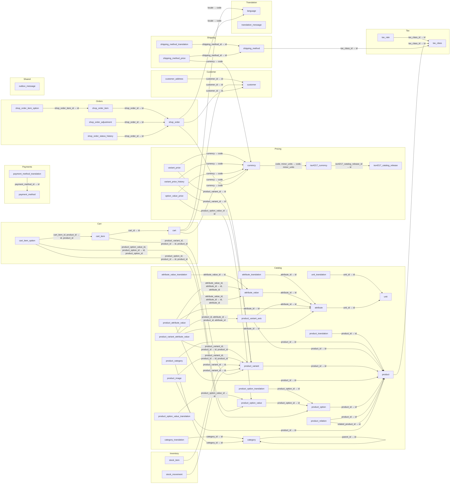

# ArgoMi-BestShop – diagram databázového schématu

**Revize:** 1.1 · 15. 11. 2026  
**Autoritativní zdroj:** aktuální dopředné SQL migrace v `migrations/structures/`  
**Databáze:** MySQL 8.x / InnoDB

Tento dokument vizualizuje skutečné tabulky a cizí klíče po aplikaci všech aktuálních strukturálních migrací. Není samostatným zdrojem pravdy: při rozporu mají přednost SQL migrace. Diagram je rozdělen do modulových skupin podle vlastnictví dat popsaného v [DATABASE.md](DATABASE.md).

## 1. Přehled tabulek podle vlastníka

Schéma obsahuje **49 tabulek** a **61 cizích klíčů**. Vlastnictví označuje odpovědnost za doménová data, nikoli oprávnění jiných modulů přistupovat přímo do cizí persistence.

| Modul | Tabulek | Oblast |
|---|---:|---|
| Catalog | 21 | Produkty, kategorie, atributy, varianty, volby a produktové vztahy. Vlastní také jednotky a jejich překlady. |
| Pricing | 6 | Měny, katalog ISO 4217, ceny variant, historie cen a ceny hodnot voleb. |
| Tax | 2 | Daňové třídy a sazby. |
| Inventory | 2 | Skladové položky a pohyby. |
| Customer | 2 | Zákazníci a jejich adresy. |
| Shipping | 3 | Způsoby dopravy, překlady a ceny dopravy. |
| Payments | 2 | Platební metody a překlady. |
| Cart | 3 | Košíky, položky košíku a zvolené možnosti. |
| Orders | 5 | Objednávky, položky, snapshoty voleb, úpravy a historie stavů. |
| Translation | 2 | Jazyky a přechodná centrální tabulka systémových překladů. |
| Shared | 1 | Technická tabulka Transactional Outbox; záměrně bez FK do obchodních tabulek. |

## 2. Význam tabulek a datové invarianty

Následující poznámky doplňují diagram o doménový význam tabulek. Neopisují všechny sloupce; jejich přesné typy, klíče a omezení jsou autoritativně definovány SQL migracemi.

| Tabulka | Význam a důležité pravidlo |
|---|---|
| `product` | Katalogový produkt; jeho identita je oddělena od konkrétních prodejných variant. |
| `attribute` / `attribute_value` | Definice vlastnosti a její číselník. Enum hodnota patří právě jednomu atributu; překlady jsou závislá lokalizovaná data. |
| `product_variant_axis` | Určuje, které atributy tvoří konfigurační osy variant konkrétního produktu. Dvojice produktu a atributu je unikátní. |
| `product_variant` | Konkrétní prodejná varianta produktu. Kombinaci atributů identifikuje stabilní SHA-256 hash kanonického zápisu. |
| `product_variant_attribute_value` | Přiřazuje variantě právě jednu hodnotu atributu. CHECK omezení vyžaduje právě jednu z enum, číselné nebo textové hodnoty; vazba na osu i použitou enum hodnotu je chráněna přes `ON DELETE RESTRICT`. |
| `product_attribute_value` | Hodnota atributu na úrovni produktu, nikoli konkrétní varianty. |
| `variant_price` / `variant_price_history` | Aktuální cena varianty a její historické body. Historie se nemaže spolu s variantou automaticky. |
| `cart_item` | Položka košíku odkazuje na variantu a ukládá identitu produktu pro kontrolu složené vazby. |
| `shop_order_item` / `shop_order_item_option` | Historický nákupní snapshot. Nesmí být závislý na aktuálním názvu, ceně ani konfiguraci katalogu. |
| `currency` / `iso4217_currency` | Obchodní měna je navázána na verzovaný katalog ISO 4217; složený FK vynucuje současnou shodu kódu a počtu minor units. |
| `outbox_message` | Technická integrační zpráva s vlastním životním cyklem; záměrně nemá obchodní FK a její payload nesmí obsahovat tajné údaje. |

## 3. Kanonizace kombinace varianty

Kombinace atributů varianty se před výpočtem hashe převádí na jediný deterministický UTF-8 řetězec. Pravidla jsou implementována v `Catalog\\Domain\\Variant\\VariantCombinationHash` a jsou součástí kontraktu mezi aplikační a databázovou kontrolou:

1. Vstup musí obsahovat alespoň jeden atribut. Kód atributu odpovídá `^[a-z][a-z0-9_]*$`.
2. Atributy se seřadí podle kódu binárním pořadím (`strcmp`), nezávisle na locale a pořadí vstupního pole.
3. Každá položka má tvar `attribute_code=canonical_value`; položky se spojí znakem `;`.
4. Hodnota se kanonizuje podle typu:
   - `enum`: neprázdný platný UTF-8 kód enum hodnoty;
   - `text`: neprázdný platný UTF-8 text;
   - `number`: desetinný řetězec odpovídající `DECIMAL(20,6)`, bez float; odstraní se koncové nuly a případná tečka, záporná nula se sjednotí s nulou;
   - `bool`: `1` pro true a `0` pro false.
5. V hodnotě se escapují rezervované znaky v tomto pořadí mapování: `%` → `%25`, `;` → `%3B`, `=` → `%3D`.
6. Výsledný řetězec se zahashuje pomocí SHA-256. Ukládá se 64 znaků hexadecimálního zápisu; PHP používá `hash('sha256', $canonical)`.

Příklad strukturálního zápisu před hashováním: `color=blue;size=large`. Pořadí atributů ve vstupu výsledek nemění. Kanonizace nesmí používat PHP `float`, databázové locale ani implicitní formátování čísel. Jednotkový test pokrývá typy, řazení, normalizaci, UTF-8, escapování a neplatné vstupy; MySQL integrační test porovnává PHP SHA-256 s SQL `SHA2(..., 256)`.

## 4. Pravidla cizích klíčů a mazání

Cizí klíče chrání referenční integritu. Volba mazací akce vyjadřuje životní cyklus závislých dat; není pouze technickým nastavením:

| Akce | Použití |
|---|---|
| `ON DELETE CASCADE` | Pouze skutečně závislá podřízená data, jejichž samostatná existence po odstranění rodiče nedává smysl (např. překlady produktu nebo řádky vazební tabulky). |
| `ON DELETE RESTRICT` | Obchodní nebo historická data, která musí zabránit odstranění odkazovaného záznamu; také referenční hodnoty používané v konfiguraci variant, cenách, skladu a objednávkách. |
| `ON DELETE SET NULL` | Volitelná vazba, jejíž ztráta nemá odstranit vlastní záznam (např. odpojení zákazníka od košíku či objednávky). |

Závazné zvláštní případy:

- `product_variant_attribute_value` → `product_variant_axis`: `RESTRICT`. Osa se nesmí odstranit, dokud je použita variantou.
- `product_variant_attribute_value` → `attribute_value`: `RESTRICT`. Použitá enum hodnota se nesmí odstranit. Její překlady zůstávají závislými lokalizovanými daty a mohou být odstraněny kaskádou až po povoleném odstranění samotné hodnoty.
- `product_variant_attribute_value` → `product_variant`: `CASCADE` zůstává zachováno pro odstranění celé varianty; chráněna jsou její jednotlivá přiřazení před nepřímým smazáním osy nebo hodnoty.
- `product_variant` → `product`: odstranění produktu může odstranit jeho varianty; samostatné reference z cen, skladu, košíku a dalších obchodních záznamů však mohou odstranění omezit dalšími FK.
- `category.parent_id`: `RESTRICT`, aby odstranění rodičovské kategorie nezanechalo osiřelou hierarchii.
- Ceny a skladové záznamy používají `RESTRICT` vůči variantě; historické obchodní záznamy se nesmějí ztratit pouhou změnou katalogu.

Před změnou mazací akce se musí posoudit celý řetězec navazujících FK a obchodní význam dat. Kaskáda je vhodná pro čistě odvozená/dependentní data, nikoli pro hodnoty variant, cenovou historii, skladové pohyby nebo objednávkové snapshoty. Změny existujícího schématu se provádějí výhradně novou dopřednou migrací; historické migrace se nepřepisují.

## 5. Vztahy tabulek po modulech

Šipka vede od tabulky obsahující cizí klíč k odkazované tabulce. Popisek uvádí dvojici zdrojových a cílových sloupců ve stejném pořadí; u složených FK jsou uvedeny všechny sloupce. Vazby mezi různými subgrafy jsou záměrné a zobrazují skutečné databázové FK přes hranice vlastnických modulů.

## 6. Poznámky k interpretaci

- Diagram zahrnuje také složené cizí klíče, samovazbu `category.parent_id`, obě vazby `product_relation` na `product` a vazby měny/jazyka přes přirozené kódy.
- Tabulka `currency` má složený FK `(code, minor_units)` do `iso4217_currency(code, minor_units)`; tím databáze vynucuje shodu kódu a přesnosti měny.
- `iso4217_currency.iso4217_catalog_release_id` odkazuje na verzované vydání katalogu ISO 4217.
- `outbox_message` nemá FK do obchodních tabulek. Outbox je technická integrační hranice; vazba na obchodní událost je vyjádřena stabilním názvem události a payloadem, nikoli databázovým FK.
- Absence FK v diagramu neznamená absenci aplikačního vztahu. Diagram zobrazuje pouze fyzické databázové cizí klíče, nikoli logické vazby, které jsou záměrně bez FK.

## 7. Zdrojové migrace

- `migrations/structures/2026-11-04-200000-init.sql` – počáteční schéma.
- `migrations/structures/2026-11-15-120000-transactional-outbox.sql` – `outbox_message`.
- `migrations/structures/2026-11-15-130000-iso4217-currency-catalog.sql` – katalog ISO 4217 a složený FK měny.
- `migrations/structures/2026-11-15-140000-normalize-iso4217-release-fk.sql` – přejmenování FK sloupce na `iso4217_catalog_release_id`.
- `migrations/structures/2026-11-15-150000-protect-variant-attribute-values.sql` – ochrana hodnot variant před nepřímým smazáním osy nebo enum hodnoty pomocí `ON DELETE RESTRICT`.

Při změně schématu se diagram aktualizuje ve stejném kroku jako příslušná migrace. Nikdy neupravuj historické migrace jen kvůli změně diagramu.

