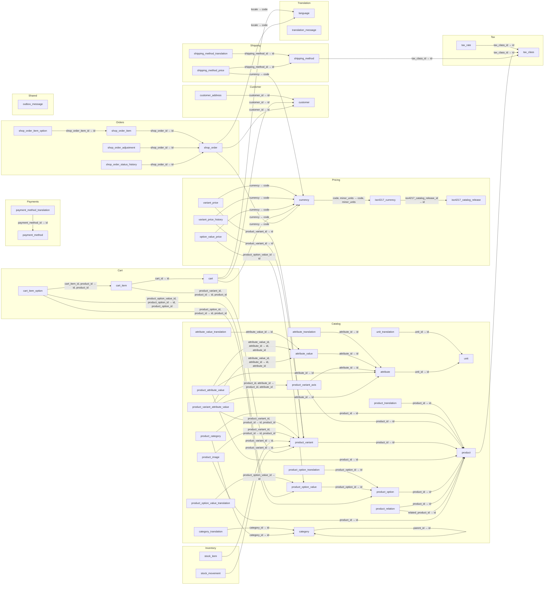

# ArgoMi-BestShop – diagram databázového schématu

**Revize:** 1.0 · 15. 11. 2026  
**Autoritativní zdroj:** aktuální dopředné SQL migrace v `migrations/structures/`  
**Databáze:** MySQL 8.x / InnoDB

Tento dokument vizualizuje skutečné tabulky a cizí klíče po aplikaci všech aktuálních strukturálních migrací. Není samostatným zdrojem pravdy: při rozporu mají přednost SQL migrace. Diagram je rozdělen do modulových skupin podle vlastnictví dat popsaného v [DATABASE.md](DATABASE.md).

## 1. Přehled tabulek podle vlastníka

Schéma obsahuje **49 tabulek** a **61 cizích klíčů**. Vlastnictví označuje odpovědnost za doménová data, nikoli oprávnění jiných modulů přistupovat přímo do cizí persistence.

| Modul | Tabulek | Oblast |
|---|---:|---|
| Catalog | 21 | Produkty, kategorie, atributy, varianty, volby a produktové vztahy. Vlastní také jednotky a jejich překlady. |
| Pricing | 6 | Měny, katalog ISO 4217, ceny variant, historie cen a ceny hodnot voleb. |
| Tax | 2 | Daňové třídy a sazby. |
| Inventory | 2 | Skladové položky a pohyby. |
| Customer | 2 | Zákazníci a jejich adresy. |
| Shipping | 3 | Způsoby dopravy, překlady a ceny dopravy. |
| Payments | 2 | Platební metody a překlady. |
| Cart | 3 | Košíky, položky košíku a zvolené možnosti. |
| Orders | 5 | Objednávky, položky, snapshoty voleb, úpravy a historie stavů. |
| Translation | 2 | Jazyky a přechodná centrální tabulka systémových překladů. |
| Shared | 1 | Technická tabulka Transactional Outbox; záměrně bez FK do obchodních tabulek. |

## 2. Vztahy tabulek po modulech

Šipka vede od tabulky obsahující cizí klíč k odkazované tabulce. Popisek uvádí dvojici zdrojových a cílových sloupců ve stejném pořadí; u složených FK jsou uvedeny všechny sloupce. Vazby mezi různými subgrafy jsou záměrné a zobrazují skutečné databázové FK přes hranice vlastnických modulů.

## 3. Poznámky k interpretaci

- Diagram zahrnuje také složené cizí klíče, samovazbu `category.parent_id`, obě vazby `product_relation` na `product` a vazby měny/jazyka přes přirozené kódy.
- Tabulka `currency` má složený FK `(code, minor_units)` do `iso4217_currency(code, minor_units)`; tím databáze vynucuje shodu kódu a přesnosti měny.
- `iso4217_currency.iso4217_catalog_release_id` odkazuje na verzované vydání katalogu ISO 4217.
- `outbox_message` nemá FK do obchodních tabulek. Outbox je technická integrační hranice; vazba na obchodní událost je vyjádřena stabilním názvem události a payloadem, nikoli databázovým FK.
- Absence FK v diagramu neznamená absenci aplikačního vztahu. Diagram zobrazuje pouze fyzické databázové cizí klíče, nikoli logické vazby, které jsou záměrně bez FK.

## 4. Zdrojové migrace

- `migrations/structures/2026-11-04-200000-init.sql` – počáteční schéma.
- `migrations/structures/2026-11-15-120000-transactional-outbox.sql` – `outbox_message`.
- `migrations/structures/2026-11-15-130000-iso4217-currency-catalog.sql` – katalog ISO 4217 a složený FK měny.
- `migrations/structures/2026-11-15-140000-normalize-iso4217-release-fk.sql` – přejmenování FK sloupce na `iso4217_catalog_release_id`.

Při změně schématu se diagram aktualizuje ve stejném kroku jako příslušná migrace. Nikdy neupravuj historické migrace jen kvůli změně diagramu.
