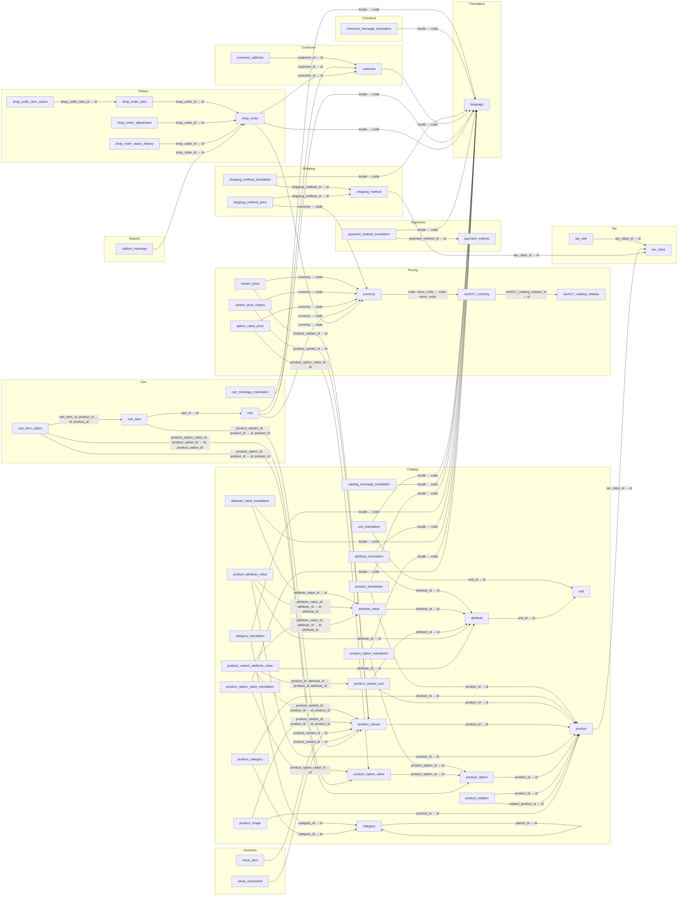

# ArgoMi-BestShop – diagram databázového schématu

**Revize:** 1.8 · 15. 11. 2026  
**Autoritativní zdroj:** aktuální dopředné SQL migrace v `migrations/structures/`  
**Databáze:** MySQL 8.x / InnoDB

Tento dokument vizualizuje skutečné tabulky a cizí klíče po aplikaci všech aktuálních strukturálních migrací. Není samostatným zdrojem pravdy: při rozporu mají přednost SQL migrace. Diagram je rozdělen do modulových skupin podle vlastnictví dat popsaného v [DATABASE.md](DATABASE.md).

## 1. Přehled tabulek podle vlastníka

Schéma obsahuje **51 tabulek** a **75 cizích klíčů**. Vlastnictví označuje odpovědnost za doménová data, nikoli oprávnění jiných modulů přistupovat přímo do cizí persistence.

| Modul | Tabulek | Oblast |
|---|---:|---|
| Catalog | 22 | Produkty, kategorie, atributy, varianty, volby, produktové vztahy a katalogové systémové texty. Vlastní také jednotky a jejich překlady. |
| Pricing | 6 | Měny, katalog ISO 4217, ceny variant, historie cen a ceny hodnot voleb. |
| Tax | 2 | Daňové třídy a sazby. |
| Inventory | 2 | Skladové položky a pohyby. |
| Customer | 2 | Zákazníci a jejich adresy. |
| Shipping | 3 | Způsoby dopravy, překlady a ceny dopravy. |
| Payments | 2 | Platební metody a překlady. |
| Cart | 4 | Košíky, položky košíku, zvolené možnosti a systémové texty košíku. |
| Orders | 5 | Objednávky, položky, snapshoty voleb, úpravy a historie stavů. |
| Checkout | 1 | Systémové texty průchodu objednávkou. |
| Translation | 1 | Společný jazykový katalog a překladová infrastruktura. |
| Shared | 1 | Technická tabulka Transactional Outbox; nese volitelnou vazbu na objednávku pro ochranu demo dat. |

## 2. Význam tabulek a datové invarianty

Následující poznámky doplňují diagram o doménový význam tabulek. Neopisují všechny sloupce; jejich přesné typy, klíče a omezení jsou autoritativně definovány SQL migracemi.

| Tabulka | Význam a důležité pravidlo |
|---|---|
| `product` | Katalogový produkt; jeho identita je oddělena od konkrétních prodejných variant. Produkt se nemaže, ale archivuje změnou `status` na `archived`; databázový trigger odmítá přímé `DELETE` a při archivaci deaktivuje všechny aktivní varianty. |
| `attribute` / `attribute_value` | Definice vlastnosti a její číselník. Enum hodnota patří právě jednomu atributu; překlady jsou závislá lokalizovaná data. |
| `product_variant_axis` | Určuje, které atributy tvoří konfigurační osy variant konkrétního produktu. Dvojice produktu a atributu je unikátní. |
| `product_variant` | Konkrétní prodejná varianta produktu. Kombinaci atributů identifikuje stabilní SHA-256 hash kanonického zápisu. Varianta se nemaže, ale deaktivuje přes `is_active = 0`; databáze odmítá přímé `DELETE`, aktivní variantu archivovaného produktu i opětovnou aktivaci varianty archivovaného produktu. Výchozí varianta je označena `is_default`; generovaný `default_flag` a unikátní index `(product_id, default_flag)` dovolují nejvýše jednu výchozí variantu produktu. Přepnutí probíhá v jedné transakci: nejprve se dosavadní výchozí varianta uvolní a poté se nastaví nová. |
| `product_variant_attribute_value` | Přiřazuje variantě právě jednu hodnotu atributu. CHECK omezení vyžaduje právě jednu z enum, číselné nebo textové hodnoty; vazba na osu i použitou enum hodnotu je chráněna přes `ON DELETE RESTRICT`. |
| `product_attribute_value` | Hodnota atributu na úrovni produktu, nikoli konkrétní varianty. |
| `variant_price` / `variant_price_history` | Aktuální cena varianty a její historické body. Historie se nemaže spolu s variantou automaticky. |
| `stock_item` / `stock_movement` | Aktuální stav zásoby varianty a neměnný skladový deník. Demo seed vytváří pro každou variantu s kladným počátečním stavem právě jeden příjem `demo_opening_balance`, jehož množství odpovídá `stock_item.quantity_on_hand`. Pohyby navázané přes `reference_type = 'shop_order'` jsou databázově zakázány pro demo objednávky. |
| `catalog_message_translation` / `cart_message_translation` / `checkout_message_translation` | Systémové texty vlastní příslušné domény. Každá tabulka uchovává stabilní `message_key` a jazykové znění; klíč je unikátní v rámci locale a tabulky. Společná tabulka `language` zůstává vlastnictvím infrastruktury Translation. |
| `cart_item` | Položka košíku odkazuje na variantu a ukládá identitu produktu pro kontrolu složené vazby. |
| `shop_order` | Objednávka uchovává účetní souhrny v minor units. `adjustments_net_minor` je čistý součet úprav; `grand_total_minor` musí odpovídat součtu mezisoučtu, čistých úprav a daně. `placed_at IS NOT NULL` uzavírá finanční snapshot. `is_demo = 1` označuje demonstrační objednávku; její klasifikace je po založení neměnná a databáze nedovolí zařadit ji do provozního Outboxu. |
| `shop_order_item` / `shop_order_item_option` | Historický nákupní snapshot. Hrubá částka řádku musí být součtem čisté částky a daně; po uzavření objednávky jsou položky i jejich volby neměnné. Snapshot nesmí být závislý na aktuálním názvu, ceně ani konfiguraci katalogu. |
| `shop_order_adjustment` | Historická úprava objednávky (např. doprava nebo sleva); hrubá částka je součtem čisté částky a daně. Souhrn čistých úprav je uložen v `shop_order.adjustments_net_minor`. Po uzavření objednávky nelze úpravy měnit. |
| `currency` / `iso4217_currency` | Obchodní měna je navázána na verzovaný katalog ISO 4217; složený FK vynucuje současnou shodu kódu a počtu minor units. |
| `outbox_message` | Technická integrační zpráva s vlastním životním cyklem. Volitelný `shop_order_id` odkazuje na objednávku; události `order.*` jej musí uvádět a databáze odmítá vazbu na demo objednávku. Stejná ochrana platí pro skladové pohyby s `reference_type = 'shop_order'`. Payload nesmí obsahovat tajné údaje. |

## 3. Kanonizace kombinace varianty

Kombinace atributů varianty se před výpočtem hashe převádí na jediný deterministický UTF-8 řetězec. Pravidla jsou implementována v `App\Modules\Catalog\Domain\Variant\VariantCombinationHash` a jsou součástí kontraktu mezi aplikační a databázovou kontrolou:

1. Vstup musí obsahovat alespoň jeden atribut. Kód atributu odpovídá `^[a-z][a-z0-9_]*$`.
2. Atributy se seřadí podle kódu binárním pořadím (`strcmp`), nezávisle na locale a pořadí vstupního pole.
3. Každá položka má tvar `attribute_code=canonical_value`; položky se spojí znakem `;`.
4. Hodnota se kanonizuje podle typu:
   - `enum`: neprázdný platný UTF-8 kód enum hodnoty;
   - `text`: neprázdný platný UTF-8 text;
   - `number`: desetinný řetězec odpovídající `DECIMAL(20,6)`, bez float; odstraní se koncové nuly a případná tečka, záporná nula se sjednotí s nulou;
   - `bool`: `1` pro true a `0` pro false.
5. V hodnotě se escapují rezervované znaky v tomto pořadí mapování: `%` → `%25`, `;` → `%3B`, `=` → `%3D`.
6. Výsledný řetězec se zahashuje pomocí SHA-256. Ukládá se 64 znaků hexadecimálního zápisu; PHP používá `hash('sha256', $canonical)`.

Příklad strukturálního zápisu před hashováním: `color=blue;size=large`. Pořadí atributů ve vstupu výsledek nemění. Kanonizace nesmí používat PHP `float`, databázové locale ani implicitní formátování čísel. Jednotkový test pokrývá typy, řazení, normalizaci, UTF-8, escapování a neplatné vstupy; MySQL integrační test porovnává PHP SHA-256 s SQL `SHA2(..., 256)`.

## 4. Pravidla cizích klíčů a mazání

Cizí klíče chrání referenční integritu. Volba mazací akce vyjadřuje životní cyklus závislých dat; není pouze technickým nastavením:

| Akce | Použití |
|---|---|
| `ON DELETE CASCADE` | Pouze skutečně závislá podřízená data, jejichž samostatná existence po odstranění rodiče nedává smysl (např. překlady produktu nebo řádky vazební tabulky). |
| `ON DELETE RESTRICT` | Obchodní nebo historická data, která musí zabránit odstranění odkazovaného záznamu; také referenční hodnoty používané v konfiguraci variant, cenách, skladu a objednávkách. |
| `ON DELETE SET NULL` | Volitelná vazba, jejíž ztráta nemá odstranit vlastní záznam (např. odpojení zákazníka od košíku či objednávky). |

Závazné zvláštní případy:

- Všech 15 sloupců `locale` odkazuje na `language(code)`. Povinné locale v překladových tabulkách (`unit_translation`, `catalog_message_translation`, `cart_message_translation`, `checkout_message_translation`, `product_translation`, `category_translation`, `attribute_translation`, `attribute_value_translation`, `product_option_translation`, `product_option_value_translation`, `shipping_method_translation` a `payment_method_translation`) používá `ON DELETE RESTRICT`, takže jazyk nelze odstranit, dokud existují jeho překlady. `cart.locale` a `shop_order.locale` rovněž používají `RESTRICT`. Volitelné `customer.locale` používá `ON DELETE SET NULL`; odstranění jazyka tedy zákazníka zachová a pouze zruší jeho preferované locale.

- `product_variant_attribute_value` → `product_variant_axis`: `RESTRICT`. Osa se nesmí odstranit, dokud je použita variantou.
- `product_variant_attribute_value` → `attribute_value`: `RESTRICT`. Použitá enum hodnota se nesmí odstranit. Její překlady zůstávají závislými lokalizovanými daty a mohou být odstraněny kaskádou až po povoleném odstranění samotné hodnoty.
- `product_variant_attribute_value` → `product_variant`: `CASCADE` zůstává zachováno pro odstranění celé varianty; chráněna jsou její jednotlivá přiřazení před nepřímým smazáním osy nebo hodnoty.
- `product_variant` → `product`: FK používá `ON DELETE RESTRICT`; produkt ani jeho varianty se fyzicky nemažou. Produkt se archivuje přes `product.status = 'archived'`, což automaticky deaktivuje všechny jeho aktivní varianty (`is_active = 0`). Databázové triggery odmítají přímé mazání produktu i varianty, vložení aktivní varianty k archivovanému produktu a opětovnou aktivaci varianty archivovaného produktu. Historické vazby a záznamy tak zůstávají zachovány.
- `category.parent_id`: `RESTRICT`, aby odstranění rodičovské kategorie nezanechalo osiřelou hierarchii.
- Ceny a skladové záznamy používají `RESTRICT` vůči variantě; historické obchodní záznamy se nesmějí ztratit pouhou změnou katalogu.

Před změnou mazací akce se musí posoudit celý řetězec navazujících FK a obchodní význam dat. Kaskáda je vhodná pro čistě odvozená/dependentní data, nikoli pro hodnoty variant, cenovou historii, skladové pohyby nebo objednávkové snapshoty. Změny existujícího schématu se provádějí výhradně novou dopřednou migrací; historické migrace se nepřepisují.

## 5. Účetní invarianty objednávek

Finanční hodnoty objednávky se ukládají jako celočíselné částky v minor units. Databáze chrání lokální aritmetické vztahy pomocí `CHECK` a agregované vztahy i životní cyklus snapshotu pomocí triggerů.

### 5.1. Výpočet souhrnů

Pro každou položku objednávky platí:

\[
line\_gross\_minor = line\_net\_minor + line\_tax\_minor
\]

Pro objednávku platí:

\[
adjustments\_net\_minor = \sum shop\_order\_adjustment.amount\_net\_minor
\]

\[
grand\_total\_minor = subtotal\_net\_minor + adjustments\_net\_minor + tax\_total\_minor
\]

`tax_total_minor` zahrnuje daň z položek i daň z úprav. Hrubá částka každé úpravy je samostatně kontrolována jako součet její čisté částky a daně (`amount_gross_minor = amount_net_minor + amount_tax_minor`).

### 5.2. Kontrola při uzavření objednávky

Přechod `placed_at` z `NULL` na neprázdnou hodnotu představuje uzavření účetního snapshotu. Při tomto přechodu databázový trigger ověřuje agregované součty položek a úprav proti souhrnům objednávky. Nekonzistentní objednávku nelze uzavřít.

`CHECK` omezení souhrnu `grand_total_minor` platí i pro draft objednávky; nejde pouze o kontrolu při uzavření. `CHECK` omezení hrubé částky položky obdobně platí pro každý řádek bez ohledu na stav objednávky.

### 5.3. Neměnnost po uzavření

Po `placed_at IS NOT NULL` databáze odmítá:
- změnu finančních souhrnů, měny, režimu `prices_include_tax` a času uzavření;
- vložení, změnu nebo odstranění položek objednávky;
- vložení, změnu nebo odstranění úprav objednávky;
- vložení, změnu nebo odstranění snapshotů voleb položek;
- odstranění uzavřené objednávky.

Triggery na podřízených tabulkách zamykají nadřazenou objednávku pomocí `SELECT ... FOR UPDATE` před kontrolou jejího stavu. Tím serializují souběžné změny položek, úprav a voleb s uzavřením objednávky. Změny nefinančních údajů objednávky, například stavu nebo kontaktního e-mailu, zůstávají povolené, pokud nemění uzavřený účetní snapshot.

Agregace napříč tabulkami nelze v MySQL vyjádřit běžným `CHECK`; proto jsou ověřovány při uzavření triggerem. Lokální aritmetické invarianty zůstávají v `CHECK` omezeních, aby chránily i drafty.
## 6. Vztahy tabulek po modulech

Šipka vede od tabulky obsahující cizí klíč k odkazované tabulce. Popisek uvádí dvojici zdrojových a cílových sloupců ve stejném pořadí; u složených FK jsou uvedeny všechny sloupce. Vazby mezi různými subgrafy jsou záměrné a zobrazují skutečné databázové FK přes hranice vlastnických modulů.

## 7. Poznámky k interpretaci

- Diagram zahrnuje také složené cizí klíče, samovazbu `category.parent_id`, obě vazby `product_relation` na `product` a vazby měny/jazyka přes přirozené kódy.
- Tabulka `currency` má složený FK `(code, minor_units)` do `iso4217_currency(code, minor_units)`; tím databáze vynucuje shodu kódu a přesnosti měny.
- `iso4217_currency.iso4217_catalog_release_id` odkazuje na verzované vydání katalogu ISO 4217.
- `outbox_message.shop_order_id` je volitelný FK na `shop_order`. Každá událost s prefixem `order.` musí uvést ID objednávky; databázové triggery odmítnou demo objednávku. Ostatní typy Outbox zpráv mohou zůstat bez objednávkové vazby.
- Diagram zobrazuje fyzické databázové cizí klíče; další logické vazby mohou být vyjádřeny pouze aplikačně.

## 8. Zdrojové migrace

- `migrations/structures/2026-11-04-200000-init.sql` – počáteční schéma.
- `migrations/structures/2026-11-15-120000-transactional-outbox.sql` – `outbox_message`.
- `migrations/structures/2026-11-15-130000-iso4217-currency-catalog.sql` – katalog ISO 4217 a složený FK měny.
- `migrations/structures/2026-11-15-140000-normalize-iso4217-release-fk.sql` – přejmenování FK sloupce na `iso4217_catalog_release_id`.
- `migrations/structures/2026-11-15-150000-protect-variant-attribute-values.sql` – ochrana hodnot variant před nepřímým smazáním osy nebo enum hodnoty pomocí `ON DELETE RESTRICT`.
- `migrations/structures/2026-11-15-160000-add-language-foreign-keys-to-locales.sql` – doplnění 11 chybějících FK `locale` → `language(code)`; povinné překlady používají `RESTRICT`, volitelné locale zákazníka `SET NULL`.
- `migrations/structures/2026-11-15-170000-order-accounting-invariants.sql` – účetní invarianty objednávek: souhrnná čistá hodnota úprav, kontroly hrubých částek, agregované ověření při uzavření a neměnnost uzavřeného snapshotu.
- `migrations/structures/2026-11-15-180000-archive-products-and-variants.sql` – archivace produktů a deaktivace variant, FK `ON DELETE RESTRICT` a databázové triggery zakazující fyzické mazání a neplatnou aktivaci variant.
- `migrations/structures/2026-11-15-210000-split-system-message-translations.sql` – rozdělení systémových textů do vlastnických tabulek Catalog, Cart a Checkout; převod zachovává ID i všechna data a starou tabulku odstraní až po úplné kontrole shody.
- `migrations/structures/2026-11-15-220000-protect-demo-orders.sql` – klasifikace demo objednávek, neměnnost příznaku, FK Outboxu a databázové triggery blokující provozní Outbox události i skladové pohyby demo objednávek.

## 9. Demo data

Demo seed rozšiřuje základní katalog a obchodní příklady; samostatná seed migrace označuje všechny čtyři ukázkové objednávky:

- `migrations/dummy-data/2026-11-15-190000-complete-demo-data.sql` doplňuje české a anglické krátké i dlouhé popisy a SEO metadata tří demo produktů; vytváří úplné adresní a položkové snapshoty dvou dalších uzavřených objednávek; doplňuje snapshot zvolené produktové možnosti, dopravy a historie stavů; zakládá počáteční skladové příjmy a systémové texty pro katalog, košík a checkout.
- `migrations/dummy-data/2026-11-15-200000-complete-demo-short-descriptions.sql` zpřesňuje dva krátké popisy tak, aby byly samostatně srozumitelné a splňovaly minimální délku ověřovanou testem.
- `migrations/dummy-data/2026-11-15-230000-classify-demo-orders.sql` označuje objednávky `2026-000001` až `2026-000004` jako demo a ověřuje jejich úplnost.
- `DemoDataIntegrity.phpt` ověřuje úplnost lokalizací, účetní a adresní snapshoty objednávek, označení demo objednávek, skladové počáteční pohyby i systémové texty.
- `DemoOrderIsolationIntegration.phpt` ověřuje zákaz provozních Outbox událostí a skladových pohybů pro demo objednávky, neměnnost klasifikace a zachování běžného objednávkového provozu. `DatabaseProductRepositoryIntegration.phpt` ověřuje, že katalogový repozitář vrací aktuální demo texty.

Při změně schématu se diagram aktualizuje ve stejném kroku jako příslušná migrace. Nikdy neupravuj historické migrace jen kvůli změně diagramu.

